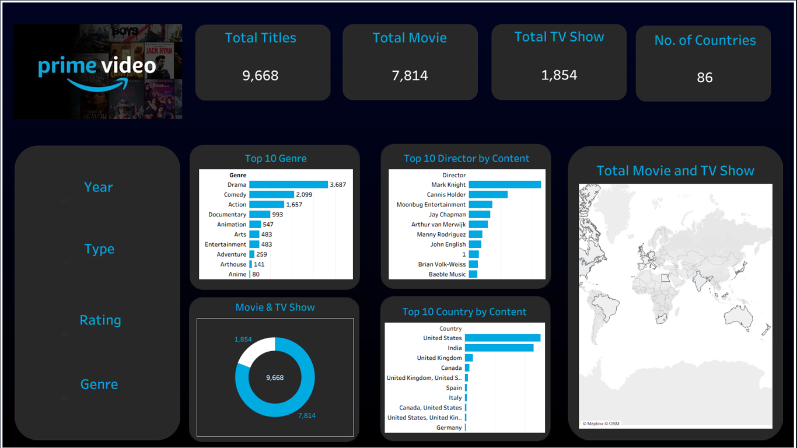

# Amazon Prime Video Dashboard | Databricks & Tableau📊🎬

## 📌 Project Overview

This project focuses on analyzing Amazon Prime Video's content catalog using Databricks and data visualization techniques.

The objective is to explore movies and TV shows, identify content distribution patterns, analyze genres and ratings, and generate meaningful insights from the dataset.

The project demonstrates data analytics, SQL-based analysis, data processing, and dashboard development.

## 🎯 Project Objectives

- Analyze Amazon Prime Video's content library.
- Understand the distribution of Movies and TV Shows.
- Identify the most popular genres by content availability.
- Explore country-wise content distribution.
- Analyze content ratings and release-year trends.
- Develop interactive visualizations for better data understanding.

## 📊 Key Analysis Areas

- Total Movies and TV Shows
- Content Distribution by Type
- Genre Analysis
- Country-wise Content Distribution
- Top Directors by Content
- Ratings Analysis
- Release Year Analysis
- Geographic Content Distribution

## 🛠️ Tools & Technologies

- Databricks
- SQL
- Tableau / Power BI *(update according to your actual dashboard tool)*
- Data Cleaning & Transformation
- Data Visualization
- Exploratory Data Analysis (EDA)

## 📁 Project Structure

```text
amazon-prime-video-dashboard/
│
├── README.md
├── screenshots/
├── data/
├── tableau/
├── output/
└── video/
```

## 📷 Dashboard Preview

### Dashboard Overview




## 💡 Key Business Questions

- What is the overall content distribution between Movies and TV Shows?
- Which genres have the highest content representation?
- Which countries contribute the most titles?
- What are the most common content ratings?
- How has content availability evolved over time?

## 📈 Project Outcomes

This project demonstrates how data analytics and visualization can transform raw streaming data into meaningful insights.

It highlights the importance of data-driven decision-making in understanding content distribution and entertainment trends.

## 👨‍💻 Author

**Bhaskar Patel**

Aspiring Data Analyst | Data Science Enthusiast

GitHub: [Bhaskar3010](https://github.com/Bhaskar3010)

## ⭐ Feedback

If you find this project interesting, feel free to explore the repository and share your feedback!
